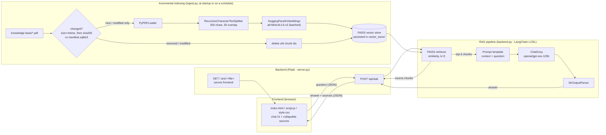

# Basic RAG Application

A small Retrieval-Augmented Generation (RAG) app. It answers questions from PDFs in the `knowledge base/` folder. It has a Flask backend, a LangChain pipeline, a FAISS vector store and a plain HTML/JS chat UI.

## Architecture



### Request flow

1. **Indexing (startup, incremental).** Importing `backend.py` calls `sync_vector_store()` in `ingest.py`. It loads the FAISS index saved in `vector_store/` and compares `knowledge base/*.pdf` with a SQLite manifest. Only new or changed PDFs are split into 300-character chunks with 50 characters of overlap and embedded with `all-MiniLM-L6-v2`. Chunks of removed PDFs are deleted. Unchanged PDFs are not even read. The index is then saved back to disk atomically. If the embedding model or chunk settings change, the index is rebuilt automatically.
2. **Question.** The browser sends `POST /api/ask` with `{ "question": "..." }`.
3. **Retrieval.** The retriever returns the 3 chunks most similar to the question.
4. **Generation.** The chunks are inserted into a prompt that tells the LLM to answer only from the context. If the answer isn't in the context, the LLM replies: *"I don't know, it's not in my knowledge base."* The prompt goes to Groq's `openai/gpt-oss-120b`, with `max_tokens=500`.
5. **Response.** The server returns `{ answer, sources: [{source, page, text}] }`. The UI shows the answer with a collapsible list of the source chunks and page numbers.

## Project structure

```
Basic Rag Project/
├── backend/
│   ├── backend.py        # RAG pipeline: index -> retriever -> prompt -> LLM
│   ├── ingest.py         # Incremental indexing (also a CLI: python ingest.py [--rebuild])
│   ├── config.py         # Paths, chunking/embedding settings, batch sizes
│   └── server.py         # Flask app: /api/ask endpoint + static frontend hosting
├── frontend/
│   ├── index.html        # Chat page
│   ├── script.js         # Calls /api/ask, renders answer and sources
│   └── style.css
├── knowledge base/       # PDFs that are indexed (add your own here)
├── vector_store/         # Persisted FAISS index + manifest (generated, not committed)
├── requirements.txt
├── .env                  # API keys (not committed)
└── README.md
```

## Tech stack

| Layer           | Technology                                           |
|-----------------|------------------------------------------------------|
| Frontend        | HTML, CSS, vanilla JavaScript                        |
| API server      | Flask                                                |
| Orchestration   | LangChain (LCEL)                                     |
| Document loader | `PyPDFLoader` (pypdf)                                |
| Chunking        | `RecursiveCharacterTextSplitter`                     |
| Embeddings      | `sentence-transformers/all-MiniLM-L6-v2`             |
| Vector store    | FAISS (CPU)                                          |
| LLM             | Groq, `openai/gpt-oss-120b`                          |

## Getting started

### Prerequisites
- Python 3.10+
- A [Groq API key](https://console.groq.com/)
- A Hugging Face token (optional; it avoids rate limits when downloading the embedding model)

### Setup

```bash
git clone https://github.com/KoushikBose/Basic_Rag_Application.git
cd Basic_Rag_Application

python -m venv .venv
.venv\Scripts\activate          # Windows
# source .venv/bin/activate     # macOS / Linux

pip install -r requirements.txt
```

Create a `.env` file in the project root:

```env
GROQ_API_KEY=your_groq_key
HF_TOKEN=your_huggingface_token
```

### Run

```bash
cd backend
python server.py
```

Open <http://127.0.0.1:5000>. The first start takes a while because it downloads the embedding model and builds the index.

To test the pipeline from the command line without the UI, run `python backend.py`. It prints the vector DB as a table and answers a sample question.

## API

`POST /api/ask`

Request:
```json
{ "question": "What is RAG?" }
```

Response:
```json
{
  "answer": "...",
  "sources": [{ "source": "file.pdf", "page": 0, "text": "..." }]
}
```

An empty question returns `400`. A pipeline error returns `500`. Both have the form `{ "error": "..." }`.

## Customizing

- **Add knowledge:** drop more PDFs into `knowledge base/` and restart the server. Only the new files are embedded. You can also run `python ingest.py` (e.g. from a scheduler) to index ahead of time; the next server start then has nothing to embed.
- **Full rebuild:** `python ingest.py --rebuild`.
- **Retrieval depth:** change `k` in `search_kwargs` in `backend.py`.
- **Chunking / embedding model:** change `CHUNK_SIZE`, `CHUNK_OVERLAP` or `EMBEDDING_MODEL_NAME` in `config.py`. The index rebuilds itself on the next start.
- **Indexing knobs (env vars):** `VECTOR_STORE_DIR` (where the index lives; a local disk outside OneDrive is best), `EMBED_BATCH_SIZE` (chunks per embedding call, default 512) and `CHECKPOINT_EVERY` (chunks between saves, default 50000).
- **Model:** change the model name passed to `ChatGroq`.
